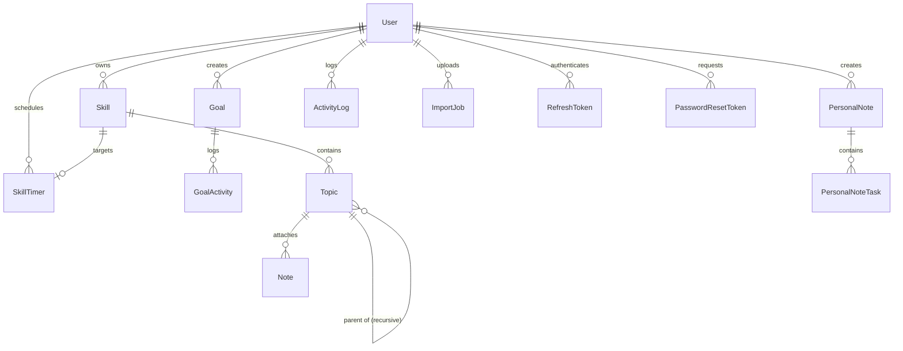

# Skill Progress Tracker

[](https://golang.org)
[](https://react.dev)
[](https://www.typescriptlang.org)
[](https://vercel.com)
[](https://supabase.com)
[](https://ai.google.dev)

**Skill Progress Tracker** is a production-grade, high-performance learning operating system that converts complex syllabi, academic curriculum PDFs, and ambitious study goals into interactive, mathematically tracked mastery roadmaps.

Engineered with an ultra-fast **Go 1.27 serverless backend** and a concurrent **React 19 Single Page Application**, the platform delivers sub-millisecond route dispatching, Google Gemini AI curriculum generation, dual-engine PDF syllabus parsing, a live analog deadline clock, continuous momentum tracking, leaf-based progress rollups, in-context topic notes, instant visual note badges, and a passkey-protected superuser administration console.

Both the **React 19 frontend** and **Go 1.27 serverless backend** deploy together on **Vercel** as a unified monorepo with an internal **HMAC-authenticated Python PDF microservice bridge**, backed by **Supabase PostgreSQL** (transaction pooler) and native **Vercel Cron** automation.

---

## What's New & Highlighted Features

- 🎯 **Target Goals & Live Countdown Clock (`/goals`, `/goals/:id`)**: Lock in ambitious target deadlines with personal motivation mantras. Features a centerpiece **live analog clock with animated sweeping hands**, embedded digital countdown unit badges (years, months, days, hours, minutes, seconds), a **"What I Did Today" 50-character daily action log** in a 7-day weekly grid, a **Dynamic Inactivity Tracker** (*"You did nothing from X days to reach this goal"* vs *"On track • Active in last 24h"*), 3-day inactivity alerts, milestone trophy celebrations, and a dedicated 72-hour soft-delete recovery trash bin.
- 📈 **Continuous Momentum Trajectory Curve (`ConsistencyGraph.tsx`)**: Replaces static heatmaps with an interactive SVG momentum spline curve. Daily study submissions award **+1.0** (shining green upward push), while missed days apply a **-1.0** penalty (shining red downward drop, clamped at 0). Equal weighting enforces daily consistency over sporadic cramming. Includes a floating interactive hover box connected by a vertical dotted guideline.
- ⚡ **High-Throughput Go 1.27 Serverless Backend (`backend-go/`)**: Fully migrated to Go 1.27 utilizing standard library `net/http` ServeMux routing, `pgx/v5` connection pooling with SimpleProtocol (optimized for Supabase PgBouncer on port `6543`), Argon2id password security compatible with PHC strings, stateless HS256 JWT authentication with race-condition grace buffers, and direct Google Gemini REST integration.
- 📑 **Optimized PDF Syllabus Ingestion & Fast Batch Persistence**: Direct 4.5MB serverless upload limit, regex outline detection + Anthropic Claude 3.5 Haiku fallback, optimized batch inserts eliminating redundant round-trips, automated skill name deduplication, circular progress spinners, and sticky error banners.
- 📝 **Visual Note Indicators & Instant Topic Tree Loading**: The topic tree now returns a `has_notes` indicator for every node, immediately styling the notes button with a distinct maroon accent so learners know where notes reside without clicking. Auto-loads notes with tab-change cache revalidation.
- 🎠 **Interactive Feature Carousel Showcase (`HomePage.tsx`)**: An immersive landing page showcasing all 17 platform capabilities with live interactive SVG mockups, autoplay, hover-pause, category pills, and responsive layout.
- 🗑️ **Dual Trash Bin & 72-Hour Grace Recovery**: Comprehensive two-stage soft deletion safeguarding both **Skills** and **Goals** with live countdown timers and one-click instant restoration.

---

## Architecture & Serverless Deployment Model

```
                                  ┌─────────────────────────────────────────────────────────────┐
                                  │                         VERCEL EDGE                         │
                                  │                                                             │
                                  │   ┌─────────────────────────────────────────────────────┐   │
                                  │   │               React 19 SPA (Vite / TS)              │   │
                                  │   │               Static Build: frontend/dist/          │   │
                                  │   └─────────────────────────────────────────────────────┘   │
                                  │                       │                         │           │
                                  │      Rewrite /api/*   │                         │ SPA Route │
                                  │                       ▼                         │ /*        │
                                  │   ┌─────────────────────────────────────────┐   │           │
                                  │   │     Go 1.27 Serverless (api/index.go)   │   │           │
                                  │   │     • net/http Method-Aware ServeMux    │   │           │
                                  │   │     • pgx/v5 SimpleProtocol Connection  │   │           │
                                  │   │     • Argon2id PHC + HS256 JWT Pair     │   │           │
                                  │   │     • Google Gemini REST Integration    │   │           │
                                  │   │     • Max Duration: 60s                 │   │           │
                                  │   └────────────────────┬────────────────────┘   │           │
                                  │                        │                        │           │
                                  │        HMAC-SHA256     │ Direct Stream          │           │
                                  │        Internal Bridge │ (≤ 4.5 MB)             │           │
                                  │                        ▼                        │           │
                                  │   ┌─────────────────────────────────────────┐   │           │
                                  │   │ Python Microservice (internal_pdf_parser)│  │           │
                                  │   │ • pypdf Extraction + Claude Fallback    │   │           │
                                  │   │ • Max Duration: 30s                     │   │           │
                                  │   └─────────────────────────────────────────┘   │           │
                                  │                       │                         │           │
                                  │   ┌───────────────────┴─────────────────────┐   │           │
                                  │   │ Vercel Cron (0 0 * * *)                 │   │           │
                                  │   │ Daily cleanup: /api/admin/cron/cleanup  │   │           │
                                  │   └───────────────────┬─────────────────────┘   │           │
                                  └───────────────────────┼─────────────────────────┴───────────┘
                                                          │
                                     Pooled TLS (Port 6543)
                                                          │
                                                          ▼
                                  ┌─────────────────────────────────────────────────────────────┐
                                  │                     SUPABASE POSTGRESQL                     │
                                  │                                                             │
                                  │  • pgx SimpleProtocol (Prepared Statements Disabled)        │
                                  │  • Full-Text Search (tsvector + GIN indexes)                │
                                  │  • Dedicated Goals & Goal Activities Schema                 │
                                  │  • ON DELETE CASCADE Relational Integrity                   │
                                  │  • JSONB Storage for PDF / AI Syllabus Trees                │
                                  └─────────────────────────────────────────────────────────────┘
```

- **Single Unified Vercel Monorepo**: Frontend and serverless backend coexist seamlessly in one repository. `vercel.json` coordinates building the Vite SPA, routes `/api/(.*)` to the Go handler (`api/index.go`), routes `/api/internal_pdf_parser` to the Python bridge (`api/internal_pdf_parser.py`), and serves the SPA fallback `index.html`.
- **High-Performance Go Engine**: Sub-10ms serverless cold starts with minimal memory footprint and zero CGO dependencies.
- **HMAC-Authenticated Python Micro-Bridge**: Complex PDF parsing and Anthropic Claude fallback are isolated into a lightweight Python microservice authenticated via cryptographic HMAC-SHA256 headers (`INTERNAL_PARSER_SECRET`).
- **Serverless-Optimized Database Connections**: Go's `pgx/v5` driver operates in `SimpleProtocol` mode (disabling statement caches), preventing connection exhaustion against Supabase's transaction pooler (`port 6543` / PgBouncer).
- **Automated Vercel Cron Maintenance**: Daily scheduled execution at midnight UTC (`0 0 * * *`) purges expired trash items (Skills and Goals past 72 hours) and accounts that reached their 72-hour deletion deadline, secured via Bearer `CRON_SECRET`.

---

## Comprehensive Feature Tour

### 1. Target Goals & Live Countdown Clock (`/goals`, `/goals/:id`)
- **Ambitious Target Setting**: Define high-stakes learning goals with a name (up to 100 characters), future-validated deadline date and time, target timezone, and a motivational line (up to 200 characters) displayed prominently across the interface.
- **Centerpiece Live Working Clock (`LiveClock.tsx`)**:
  - Custom analog clock dial with 12 hour ticks (major ticks at 12, 3, 6, 9) and synchronized sweeping hour, minute, and second hands.
  - Ticking digital countdown embedded directly within the dial, showing large formatted unit badges for **years**, **months**, **days**, **hours**, **minutes**, and **seconds**.
- **Dynamic Inactivity Tracker**:
  - Automatically calculates elapsed time since the user's latest recorded activity card (or goal creation if no cards exist yet).
  - Highlights real-time accountability status chips:
    - ⚠️ **Inactivity Warning**: `"You did nothing from X days to reach this goal."` (when $\ge 1$ day inactive).
    - ✨ **On Track**: `"On track • Active in last 24h"`.
- **"What I Did Today" 50-Character Activity Cards (`ActivityCards.tsx`)**:
  - Record daily progress entries constrained to a concise 50 characters, encouraging micro-habits without cognitive overload.
  - Organized in a responsive 7-card weekly layout with pagination and localized calendar dates.
- **Three-Day Inactivity Banner (`InactivityWarning.tsx`)**: Proactive visual alert triggered whenever 3 or more days pass without logged activity.
- **Milestone Trophy Celebration**: When the deadline arrives, an achievement banner displays an executive audit of **Total Tracked Days**, **Worked Days**, **Missed Days**, and **Final Momentum Score**.
- **Dedicated 72-Hour Trash Recovery**: Deleting a goal moves it to the trash bin for 72 hours before permanent purge.

```
┌────────────────────────────────────────────────────────────────────────┐
│  🎯 Master Cloud Architecture & Go                                     │
│  "Consistency beats intensity every single day."                       │
│                                                                        │
│  [✨ On track • Active in last 24h]                                    │
│                                                                        │
│                    ┌───────────────────────┐                           │
│                    │     12        1       │                           │
│                    │  10     \       2     │                           │
│                    │ 9        \───►   3    │   (Live Sweeping Clock)   │
│                    │  8               4    │                           │
│                    │     7    6    5       │                           │
│                    │  [01 y] [03 m] [14 d] │   (Embedded Countdown)    │
│                    │      [08:24:19]       │                           │
│                    └───────────────────────┘                           │
│                                                                        │
│  What I Did Today:                                                     │
│  ┌────────────────────┐ ┌────────────────────┐ ┌────────────────────┐  │
│  │ Nov 21, 2026       │ │ Nov 20, 2026       │ │ Nov 19, 2026       │  │
│  │ Built gRPC service │ │ Implemented Redis  │ │ Studied Goroutines │  │
│  └────────────────────┘ └────────────────────┘ └────────────────────┘  │
└────────────────────────────────────────────────────────────────────────┘
```

---

### 2. Account Consistency & Momentum Trajectory Curve (`ConsistencyGraph.tsx`)
- **Interactive SVG Spline Curve**: Replaces traditional flat dashboard banners with a continuous mathematical momentum graph modeling learning discipline across a 365-day rolling timeline.
- **The Discipline Scoring Formula**:
  $$\text{Daily Submission} \longrightarrow +1.0 \quad (\text{Glowing Light Green Upward Trajectory})$$
  $$\text{Missed Study Day} \longrightarrow -1.0 \quad (\text{Thin Shining Red Downward Drop, Clamped at 0})$$
- **Consistency Over Cramming**: A user submitting 1 completed topic and a user submitting 50 topics on the same calendar day both receive $+1.0$. Daily consistency is rewarded; sporadic cramming is not.
- **Interactive Guidelines & Floating Hover Card**:
  - Hovering over any data point reveals a floating card positioned above the chart, anchored by a vertical dotted guideline.
  - Displays formatted calendar date (e.g. `Nov 21, 2026`), current momentum score, active status, and point delta ($+1.0$ or $-1.0$).
- **Boundary Clamping & Headroom Scaling**: 14% ceiling headroom ensures peak momentum trajectories never touch or clip against the canvas boundaries.
- **Key Metric Indicators**: Real-time display of **Current Momentum Score**, **Active Days Ratio** (e.g., `42 of 71 days`), and **All-Time Peak Score**.

---

### 3. Automated AI Syllabus Generator (Google Gemini)
- **Instant Curriculum Synthesis**: Enter any topic, domain, or technology to receive an organized multi-level hierarchical syllabus in seconds.
- **4 Granular Depth Tiers**:
  - **Easy (Beginner)**: ~10–20 topics establishing core terminology, definitions, and mental models.
  - **Medium (Core)**: ~20–40 topics covering fundamental mechanisms, common patterns, and practical usage.
  - **Hard / Intermediate (In-Depth)**: ~40–70 topics exploring production internals, edge cases, and architectural trade-offs.
  - **Comprehensive (A-to-Z)**: ~65–110 topics delivering complete exhaustive domain coverage from zero to mastery.
- **3 Purpose-Driven Modes**:
  - **Technical Interview Prep**: Focuses on commonly asked interview concepts, system design trade-offs, and algorithmic patterns.
  - **Quiz / Exam Revision**: Emphasizes classifications, definitions, conceptual properties, and testable facts.
  - **A-to-Z Knowledge**: Structured logical curriculum covering the entire topic from first principles.
- **Serverless Timeout Guard**: Direct REST calls to Google Gemini (`gemini-3.8-flash` with fallback to `gemini-2.5-flash`) with a strict 46-second execution budget and automated JSON self-repair.

---

### 4. Interactive AI Syllabus Studio & Conversational Refinement
- **Conversational Chat Refinement**: Prompt the AI directly to adjust the generated syllabus (e.g., *"Add a section on Kafka and gRPC"*, *"Expand topic 2.1 with subtopics"*, *"Remove theoretical calculus"*).
- **Two-Stage Candidate Validation**: Proposed syllabus modifications appear as pending visual diffs with **Accept** and **Discard** actions.
- **Full Multi-Step Undo History**: Revert chat refinement steps sequentially to restore previous curriculum states.
- **Visual Tree Preview Editor**: Rename nodes inline, delete unwanted branches, or add custom child subtopics manually before saving.
- **Session Caching**: Draft syllabi and chat conversations are preserved in `sessionStorage` (`pt_ai_draft`) against accidental browser refreshes.

---

### 5. PDF Syllabus Ingestion & Dual-Engine Parser
- **Direct 4.5MB Serverless Upload**: Optimized streaming ingestion supporting syllabus PDFs up to 4.5 MB (~200 pages) directly through the Go serverless function without third-party storage overhead.
- **Dual-Engine Extraction**:
  - **Regex Engine**: Fast outline parser detecting numerical hierarchies (`1.0`, `1.1`, `1.1.1`), standard chapter titles (Unit, Module, Section), Roman numerals, and bullet structures.
  - **Anthropic Claude 3.5 Haiku Fallback**: Unstructured or ambiguous outline chunks are automatically resolved by Claude to infer accurate parent-child nesting.
- **Optimized Batch Persistence**: Database persistence uses bulk inserts, eliminating redundant client-side tree patching round-trips.
- **Auto-Deduplicating Skill Names**: If a skill with the extracted PDF title already exists, an incremental number is appended automatically.
- **Built-in Prompt Templates**: Includes copyable prompt templates for formatting external syllabi from ChatGPT or Claude into the exact format for instant import.

---

### 6. Hierarchical Topic Tree & Leaf Progress Engine
- **Arbitrary Depth N-Level Nesting**: Organize skills into modules, chapters, sections, and sub-subtopics without depth constraints.
- **Strict Leaf-Level Mathematics**: Checkboxes only appear on **leaf topics** (nodes with zero children). Progress rolls up mathematically:
  $$\text{Progress \%} = \frac{\text{Completed Leaf Topics}}{\text{Total Leaf Topics}} \times 100$$
- **Automatic State Invalidation**: If a completed leaf receives a child subtopic, its completed status is automatically cleared, and parent progress recalculates upward.
- **Visual Note Indicator (`has_notes`)**: Nodes with attached study notes immediately display a prominent visual indicator (e.g. maroon accent), eliminating guessing.
- **LineBar & Donut Visuals**: Real-time progress bars and donut gauges on every branch show completed vs total leaf counts.

---

### 7. In-Context Topic Notes
- **Embedded Slide-Out Drawer**: Access study notes directly alongside topic nodes without losing your place in the syllabus tree.
- **Markdown & Revision History**: Attach notes, cheat sheets, code snippets, and explanations directly to specific learning checkpoints.
- **Immutable Audit Trail**: Every note addition and update logs an activity record with topic and skill snapshots.

---

### 8. Personal Scratchpad & Interactive Checklists ("Make Note")
- **Standalone Daily Scratchpad (`/make-note`)**: An independent task scratchpad decoupled from long-term skills and streak requirements.
- **Checklist Cards**: Create cards with custom titles (up to 35 characters) and ordered tasks with one-click strike-through completion.
- **Debounced Auto-Save**: Background persistence triggers after a 450ms debounce with instant visual `"● Saved"` feedback.

---

### 9. Consistency Heatmap & Streak Calendar (`/streak`)
- **GitHub-Style Contribution Grid**: 365-day rolling activity matrix visualizing daily learning completions across 4 color-intensity tiers.
- **Multi-Year Archive**: Toggle between the current 12-month rolling window and past calendar years.
- **Timezone-Aware Grace Period**: Missing exactly 1 day preserves your current streak; missing 2 or more consecutive days resets the streak counter to 0.
- **Hover Tooltips**: Inspect precise calendar dates, day-of-week labels, and completion tallies.

---

### 10. Unified Multi-Entity Full-Text Search (`/search`)
- **Multi-Entity Indexing**: PostgreSQL `tsvector` + GIN index (with SQLite LIKE fallback) searching across skill names, topic names, descriptions, topic revision notes, and personal scratchpad checklists.
- **Categorized Badges & Deep Links**: Result badges (`skill`, `topic`, `note`, `personal_note`) with contextual snippets and direct `"Open in tree"` links.
- **Trash-Aware**: Automatically filters out items located in the trash bin.

---

### 11. Two-Stage Trash Safety & 72-Hour Grace Recovery (`/trash`)
- **Soft Deletion Quarantine**: Deleting a Skill or Goal moves it to the Trash bin (`/trash`) with a 72-hour recovery window.
- **Live Expiration Countdowns**: Real-time readouts (`"Permanently deleted in X days Y hours"`).
- **One-Click Restoration**: Restores skills, topic trees, notes, and goals intact.
- **Permanent Purge**: Immediate deletion with impact warning modals showing exact counts of topics and notes being erased.

---

### 12. User Settings, Timezones & Milestone Bars (`/settings`)
- **Display Name Editing**: Change user display names with inline validation.
- **50+ IANA Timezones**: Select local timezones for accurate daily streak and activity logging.
- **Per-Skill Progress Bars**: Distinct color-coded pastel progress bars for every active skill.
- **100% Milestone Celebration**: Displays celebratory banners upon completing all leaf topics in a skill.
- **Account Deletion with 72-Hour Recovery**: Requesting account deletion initiates a 72-hour recovery window. Logging in within 72 hours automatically aborts the deletion; otherwise, data is permanently erased.

---

### 13. Enterprise Security & Authentication Architecture
- **Argon2id Memory-Hard Hashing**: Native Go Argon2id hashing resistant to GPU/ASIC brute-force attacks, compatible with Python PHC hashes.
- **Dual JWT Token Pair**: 15-minute access tokens and 30-day rotated refresh tokens with a 20-second race-condition buffer for concurrent client requests.
- **Forgot Password Workflow**: 6-digit OTP verification codes (10-minute expiry, 60-second cooldown) dispatched via SMTP with STARTTLS (587) / SSL (465).
- **Google OAuth 2.0**: One-click Google Sign-In with cryptographic RS256 JWKS token verification and automatic account linking.
- **Hardened HTTP Headers**: Strict security headers applied to every response (`X-Content-Type-Options: nosniff`, `X-Frame-Options: DENY`, `Referrer-Policy: no-referrer`, `Permissions-Policy`, and HSTS in production).
- **Sliding-Window Rate Limiting**: Built-in sliding-window limiter guarding authentication endpoints and AI generation against abuse.

---

### 14. Superuser Database Administration Console (`/admin`)
- **Passkey-Protected Portal**: Access to `/admin` requires both an authorized administrator email (`ADMIN_EMAIL`) and a 12+ character Database Access Code (`ADMIN_ACCESS_CODE`).
- **Auto-Lock Security**: Admin session automatically locks (clearing cached credentials) on page unload, route change, tab switch, or window blur.
- **User Directory Audit**: Audit registered accounts with computed activity statuses (`Active`, `Not active`, `Deleted`).
- **Administrative Password Overrides**: Administrators can assign temporary passwords to users. This flags `must_change_password = True` on the user, immediately revoking active refresh tokens and forcing a password update upon next login.

---

## Tech Stack

### Frontend
| Technology | Version | Purpose |
|---|---|---|
| **React** | 19.0 | Concurrent rendering, component-driven UI architecture |
| **Vite** | 6.2 | ES module dev server, fast HMR, optimized production bundling |
| **TypeScript** | 5.8 | Strict type safety across components and API data contracts |
| **React Router** | 7.3 | Client-side routing, route guards, and nested layouts |
| **TanStack Query** | 5.67 | Server-state caching, optimistic updates, and background refetching |

### Backend (Go Serverless)
| Technology | Version | Purpose |
|---|---|---|
| **Go** | 1.27 | High-performance compiled runtime for serverless execution |
| **net/http** | Standard Library | Method-aware routing (`POST /goals`, `GET /skills/{id}`) |
| **pgx/v5** | 5.7 | PostgreSQL driver with SimpleProtocol for Supabase PgBouncer |
| **modernc.org/sqlite** | 1.34 | Pure Go SQLite driver for zero-dependency local development and CI |
| **golang.org/x/crypto/argon2** | Latest | Argon2id memory-hard password hashing |
| **golang-jwt/jwt/v5** | 5.2 | Stateless HS256 JWT access and refresh token management |
| **google/uuid** | 1.6 | Cryptographically secure UUIDv4 generation |

### Python Microservice Bridge (PDF Ingestion)
| Technology | Version | Purpose |
|---|---|---|
| **Python** | 3.11 | Specialized runtime for PDF text extraction |
| **pypdf** | 5.4 | PDF binary inspection, table of contents, and text extraction |
| **Anthropic** | 0.49 | Claude 3.5 Haiku fallback parser for low-confidence outlines |
| **HMAC-SHA256** | Standard Library | Cryptographic request verification between Go and Python functions |

### Cloud Infrastructure
| Service | Role | Configuration |
|---|---|---|
| **Vercel** | Hosting & Serverless Execution | Monorepo deployment (Vite SPA + Go Serverless Function + Python Bridge) |
| **Vercel Cron** | Scheduled Job Automation | Daily invocation of `/api/admin/cron/cleanup` (`0 0 * * *`) |
| **Supabase** | Managed PostgreSQL | Transaction-pooled database connection on port `6543` with `tsvector` + GIN indexes |

---

## Project Structure

```
.
├── api/
│   ├── index.go                      # Vercel Go Serverless Function entry point
│   └── internal_pdf_parser.py        # HMAC-authenticated Python PDF parser microservice
├── backend-go/                       # High-Performance Go 1.27 Backend
│   ├── api/                          # Go and Python function references for Vercel
│   ├── app/
│   │   └── app.go                    # Singleton handler factory for serverless execution
│   ├── cmd/
│   │   └── server/
│   │       └── main.go               # Standalone local HTTP development server (:8000)
│   ├── internal/
│   │   ├── config/                   # Environment loading, DSN normalization, secret checks
│   │   ├── core/                     # Logging, security (Argon2id, JWT), rate limiting, errors
│   │   ├── database/                 # pgx PostgreSQL driver (SimpleProtocol) & SQLite driver
│   │   ├── handlers/                 # HTTP route handlers (admin, auth, goals, skills, topics, pdf, ai)
│   │   ├── middleware/               # GZip, CORS, SecurityHeaders, ErrorRecovery, Auth guards
│   │   ├── models/                   # Domain models and request/response DTO schemas
│   │   └── services/                 # Activity, email, gemini, google, pdf_bridge, progress engines
│   ├── migrations/                   # Additive SQL migrations (e.g. goals schema)
│   ├── pybridge/                     # Python PDF parsing scripts invoked by the microservice
│   └── tests/                        # Comprehensive Go test suite & performance benchmarks
├── frontend/                         # React 19 + TypeScript + Vite SPA
│   ├── src/
│   │   ├── api/                      # Modular API clients (auth, goals, skills, topics, pdf, etc.)
│   │   ├── components/
│   │   │   ├── goals/                # LiveClock, CountdownTimer, InactivityWarning, ActivityCards
│   │   │   ├── ConsistencyGraph.tsx  # Interactive SVG momentum trajectory curve (+1.0 / -1.0)
│   │   │   ├── NotesPanel.tsx        # Slide-out drawer for topic revision notes
│   │   │   ├── TopicTree.tsx         # Hierarchical tree with leaf checkboxes & has_notes indicator
│   │   │   ├── ConfirmDialog.tsx     # Reusable confirmation modal
│   │   │   └── ProgressVisuals.tsx   # SVG circular rings and line progress bars
│   │   ├── pages/
│   │   │   ├── HomePage.tsx          # Marketing landing page with interactive feature carousel
│   │   │   ├── GoalsPage.tsx         # Target goals grid, creation modal, and 72-hour trash
│   │   │   ├── GoalDetailPage.tsx    # Live clock centerpiece, activity cards, and completion banner
│   │   │   ├── DashboardPage.tsx     # Executive command center with momentum graph & stats
│   │   │   ├── SkillsPage.tsx        # Grid view of all active skills
│   │   │   ├── SkillDetailPage.tsx   # Topic tree detail view with timer and notes drawer
│   │   │   ├── ImportPage.tsx        # PDF drag-and-drop syllabus importer (4.5 MB limit)
│   │   │   ├── GenerateAIPage.tsx    # AI curriculum generation input screen
│   │   │   ├── AIPreviewPage.tsx     # AI syllabus preview studio with conversational refinement
│   │   │   ├── MakeNotePage.tsx      # Standalone scratchpad checklists
│   │   │   ├── SearchPage.tsx        # Instant multi-entity global search interface
│   │   │   ├── StreakPage.tsx        # Detailed streak statistics and yearly calendar
│   │   │   ├── ActivityPage.tsx      # Chronological activity audit feed
│   │   │   ├── SettingsPage.tsx      # User profile, IANA timezone selector, and skill progress bars
│   │   │   ├── TrashPage.tsx         # Unified trash bin for Skills and Goals with 72h countdowns
│   │   │   └── AdminPage.tsx         # Passkey-protected superuser administration console
│   │   ├── App.tsx                   # Main router configuration and authenticated shell layout
│   │   └── styles.css                # Global responsive dark-theme design system
│   ├── package.json
│   └── vite.config.ts
├── migrations/                       # Global database migrations
├── pybridge/                         # Standalone Python PDF bridge parser
├── go.mod                            # Go module configuration
├── go.sum
├── requirements.txt                  # Python dependencies for the PDF parser microservice
└── vercel.json                       # Vercel deployment routes, functions, headers, and cron
```

---

## Database Design & Entity Relationships



### Models Summary
- **User**: Core account identity with Argon2id password hash, optional `google_id`, IANA `timezone`, `must_change_password` flag, and `deletion_deadline` for 72-hour grace recovery.
- **Goal**: High-level learning goal with target `deadline_at`, `motivation_line`, `timezone`, and 72-hour soft-deletion fields (`deleted_at`, `purge_at`).
- **GoalActivity**: Daily progress cards (up to 50 characters) logged against a goal with localized `activity_date`.
- **Skill**: Top-level learning domain owned by a user, containing soft-delete fields (`deleted_at`, `purge_at`).
- **Topic**: Recursive hierarchical node (`parent_id` foreign key referencing `topics.id`). Only leaf topics store `is_completed` and `completed_at`.
- **Note**: Timestamped text revision note attached directly to a specific topic.
- **PersonalNote & PersonalNoteTask**: Standalone notebook cards with checkable tasks (`order_index`, `is_completed`).
- **ActivityLog**: Immutable audit trail recording event types (`topic_completed`, `skill_created`, `ai_generated`, etc.) with captured topic/skill snapshots.
- **SkillTimer**: Start and target completion date range (`from_date`, `to_date`) attached to a specific skill for goal timeline pacing.
- **ImportJob**: Tracks PDF extraction status, confidence metadata, and generated tree structure JSON.
- **RefreshToken**: Cryptographically hashed tokens (`token_hash`) for secure 30-day session rotation.
- **PasswordResetToken**: Single-use 6-digit verification code hashes with 10-minute expirations.

---

## API Reference

### Target Goals (`/goals`)
| Method | Endpoint | Description | Auth |
|---|---|---|---|
| `GET` | `/goals` | List all active goals with activity counts and expired flags | User |
| `POST` | `/goals` | Create a new target goal with future deadline & motivation | User |
| `GET` | `/goals/trash` | List all goals currently in the 72-hour trash bin | User |
| `GET` | `/goals/{goal_id}` | Retrieve goal details, daily summary, and inactivity warnings | User |
| `DELETE` | `/goals/{goal_id}` | Move goal to trash (72-hour recovery window) | User |
| `POST` | `/goals/{goal_id}/restore` | Restore a trashed goal back to active status | User |
| `DELETE` | `/goals/{goal_id}/permanent` | Permanently purge a goal and its activities | User |
| `GET` | `/goals/{goal_id}/activities` | List paginated 50-character activity cards | User |
| `POST` | `/goals/{goal_id}/activities` | Add daily activity card (prior to deadline) | User |
| `GET` | `/goals/{goal_id}/progress` | Compute worked days, missed days, and momentum score | User |

### Authentication (`/auth`)
| Method | Endpoint | Description | Rate Limit |
|---|---|---|---|
| `POST` | `/auth/register` | Register new account with email & password | 8 / 15m |
| `POST` | `/auth/login` | Authenticate user & receive access/refresh token pair | 5 / 15m |
| `POST` | `/auth/refresh` | Rotate expired access token using refresh token | Standard |
| `POST` | `/auth/logout` | Revoke active refresh token | Standard |
| `POST` | `/auth/google` | Sign in / register via verified Google ID token | 8 / 15m |
| `POST` | `/auth/forgot-password` | Generate & email 6-digit OTP reset code | 5 / 15m |
| `POST` | `/auth/verify-reset-code` | Verify OTP reset code without consuming it | 8 / 15m |
| `POST` | `/auth/reset-password` | Reset password using verified reset code | 8 / 15m |
| `POST` | `/auth/change-password` | Force-change password after administrative override | User |
| `GET` | `/auth/me` | Fetch authenticated user profile & permissions | User |
| `PATCH` | `/auth/me` | Update user display name or IANA timezone | User |
| `DELETE` | `/auth/me` | Schedule account deletion (72-hour grace period) | User |

### AI Curriculum Synthesis (`/ai`)
| Method | Endpoint | Description | Rate Limit |
|---|---|---|---|
| `POST` | `/ai/generate-syllabus` | Generate hierarchical curriculum via Google Gemini | 40 / hr |
| `POST` | `/ai/refine-syllabus` | Conversationally adjust curriculum tree via prompt | 60 / hr |
| `POST` | `/ai/confirm-syllabus` | Persist finalized curriculum as a new Skill with Topics | 30 / hr |

### Skills & Trash (`/skills`)
| Method | Endpoint | Description |
|---|---|---|
| `GET` | `/skills` | List all active skills with calculated progress metrics |
| `POST` | `/skills` | Create a new empty skill |
| `GET` | `/skills/{skill_id}` | Retrieve skill details with leaf completion stats |
| `PATCH` | `/skills/{skill_id}` | Update skill name or description |
| `GET` | `/skills/{skill_id}/delete-impact` | Audit count of topics and notes that will be removed |
| `DELETE` | `/skills/{skill_id}` | Move skill to Trash (soft delete with 72-hour recovery) |
| `GET` | `/skills/trash` | List all skills currently in the Trash bin |
| `POST` | `/skills/{skill_id}/restore` | Restore a trashed skill back to active status |
| `DELETE` | `/skills/{skill_id}/permanent` | Permanently purge a skill and its topics from the database |
| `GET` | `/skills/{skill_id}/topics` | Fetch entire hierarchical topic tree with `has_notes` flags |

### Topics & Checkboxes (`/topics`)
| Method | Endpoint | Description |
|---|---|---|
| `POST` | `/topics` | Add a new root or child topic to a skill |
| `GET` | `/topics/{topic_id}` | Fetch topic metadata and derived progress |
| `GET` | `/topics/{topic_id}/children` | Fetch immediate children of a topic node |
| `POST` | `/topics/{topic_id}/complete` | Check or uncheck a leaf topic (recalculates progress) |

### In-Context Notes (`/notes`)
| Method | Endpoint | Description |
|---|---|---|
| `POST` | `/notes` | Create a revision note attached to a topic |
| `GET` | `/notes?topic_id={id}` | List all notes for a specific topic |
| `GET` | `/notes/{note_id}` | Retrieve a specific note |
| `PATCH` | `/notes/{note_id}` | Update content of an existing note |
| `DELETE` | `/notes/{note_id}` | Delete a note |

### Personal Scratchpad Checklists (`/personal-notes`)
| Method | Endpoint | Description |
|---|---|---|
| `GET` | `/personal-notes` | List all standalone scratchpad notes with tasks |
| `POST` | `/personal-notes` | Create a new scratchpad note |
| `GET` | `/personal-notes/{id}` | Retrieve a specific scratchpad note |
| `PATCH` | `/personal-notes/{id}` | Update title or checklist tasks (auto-saved) |
| `DELETE` | `/personal-notes/{id}` | Delete a scratchpad note |

### PDF Syllabus Ingestion (`/pdf`)
| Method | Endpoint | Description | Rate Limit |
|---|---|---|---|
| `POST` | `/pdf/upload` | Direct multipart stream upload (max 4.5 MB, ~200 pages) | 10 / hr |
| `GET` | `/pdf/jobs/{job_id}` | Poll asynchronous extraction and parsing status | Standard |
| `PATCH` | `/pdf/jobs/{job_id}/tree` | Modify proposed topic tree in Preview Editor | Standard |
| `POST` | `/pdf/jobs/{job_id}/confirm` | Atomically persist proposed tree into database | Standard |

### Dashboard, Momentum & Search (`/dashboard`, `/streak`, `/activity`, `/search`)
| Method | Endpoint | Description |
|---|---|---|
| `GET` | `/dashboard` | Fetch global summary statistics (skills, leaf topics, streak) |
| `GET` | `/dashboard/suggested-next`| Retrieve the next recommended topic or skill to study |
| `GET` | `/streak` | Get current and longest streak counters |
| `GET` | `/streak/calendar` | 365-day consistency calendar data for momentum & heatmap |
| `GET` | `/activity` | Retrieve recent activity audit feed (limit 20) |
| `GET` | `/search?q={query}` | Execute full-text multi-entity search across all content |

### Administration & Scheduled Cron (`/admin`)
| Method | Endpoint | Description | Security |
|---|---|---|---|
| `POST` | `/admin/unlock` | Validate Database Access Code and obtain admin token | Admin Email + Access Code |
| `GET` | `/admin/users` | List all users with computed activity statuses | Admin Bearer Token |
| `POST` | `/admin/users/{user_id}/password` | Override user password (forces change on login) | Admin Bearer Token |
| `POST` | `/admin/cleanup/expired-accounts` | Manually run account purge sweep | Admin Bearer Token |
| `GET / POST`| `/admin/cron/cleanup` | Automated daily cleanup of expired trash and accounts | Bearer `CRON_SECRET` |

---

## Deployment Guide (Vercel + Supabase)

### 1. Database Provisioning (Supabase)
1. Create a project at [supabase.com](https://supabase.com).
2. Navigate to **Project Settings → Database → Connection string**.
3. Select **Transaction Pooler** mode (port `6543`, not direct port 5432) and copy the URI.
4. Apply additive database migrations:
   ```bash
   # Run additive schema SQL against your Supabase database
   psql "$DATABASE_URL" -f migrations/001_create_goals_tables.sql
   ```

### 2. Vercel Project Configuration
1. Push your repository to GitHub.
2. In the [Vercel Dashboard](https://vercel.com), import your repository.
3. Configure the build parameters:
   - **Framework Preset**: Vite
   - **Root Directory**: `./` (coordinate from root; `vercel.json` manages both Go and Python serverless functions)
   - **Build Command**: `cd frontend && npm install && npm run build`
   - **Output Directory**: `frontend/dist`
4. Add the following **Environment Variables** in Vercel:

| Variable | Required | Description |
|---|---|---|
| `DATABASE_URL` | **Yes** | Supabase pooled Postgres URI (`postgresql://postgres.<ref>:<pass>@<host>:6543/postgres?pgbouncer=true&sslmode=require`) |
| `JWT_SECRET` | **Yes** | Access token signing secret (minimum 32 random characters) |
| `JWT_REFRESH_SECRET` | **Yes** | Refresh token secret (different 32+ character string) |
| `INTERNAL_PARSER_SECRET` | **Yes** | HMAC-SHA256 secret for Go ↔ Python microservice communication (32+ chars) |
| `ENVIRONMENT` | **Yes** | Set to `production` |
| `CRON_SECRET` | **Yes** | Shared secret used to authenticate Vercel Cron requests (min 16 chars) |
| `CLEANUP_SECRET` | **Yes** | Secret matching `CRON_SECRET` for administrative cleanup triggers |
| `GEMINI_API_KEY` | **Yes** | Google Gemini API key for AI syllabus generation |
| `GEMINI_MODEL` | No | Defaults to `gemini-3.8-flash` |
| `ADMIN_ACCESS_CODE` | Optional | Minimum 12-character passkey to unlock the superuser console |
| `ADMIN_EMAIL` | Optional | Administrator email address (default: `riteeritee251@gmail.com`) |
| `GOOGLE_CLIENT_ID` | Optional | Google OAuth 2.0 client ID |
| `GOOGLE_CLIENT_SECRET` | Optional | Google OAuth 2.0 client secret |
| `ANTHROPIC_API_KEY` | Optional | Anthropic API key for low-confidence PDF parsing fallback |
| `SMTP_HOST` | Optional | SMTP mail server hostname for sending OTP reset emails (e.g. `smtp.gmail.com`) |
| `SMTP_PORT` | Optional | SMTP port (e.g., `587`) |
| `SMTP_USER` | Optional | SMTP username |
| `SMTP_PASSWORD` | Optional | SMTP app password |
| `SMTP_FROM` | Optional | Sender email address (e.g., `noreply@yourdomain.com`) |

5. Click **Deploy**. Vercel will build the React SPA, compile the Go serverless function (`api/index.go`), deploy the Python microservice bridge (`api/internal_pdf_parser.py`), configure rewrites, and register the daily cron job.

---

## Local Development Setup

### Prerequisites
- **Go 1.22+** (Go 1.27 recommended)
- **Node.js 18+** & npm
- **Python 3.11+** (for the local PDF parsing bridge)
- **Git**

### 1. Clone & Prepare Environment
```bash
git clone https://github.com/your-username/skill-progress-tracker.git
cd "skill-progress-tracker"
copy backend-go\.env.example .env
```
*(On macOS/Linux, use `cp backend-go/.env.example .env`)*

### 2. Run the Go Backend
```bash
cd backend-go
go run ./cmd/server
```
The server will read `.env` and start listening on `http://localhost:8000`.

### 3. Run the React Frontend
In a separate terminal:
```bash
cd frontend
npm install
npm run dev
```
Open your browser at `http://localhost:5173`. Vite will automatically proxy API requests to the Go backend on port 8000.

### 4. Running Backend Tests & Benchmarks
The Go test suite covers full end-to-end integration, security isolation, Argon2id compatibility, PDF bridges, goal lifecycles, and performance benchmarks:
```bash
cd backend-go

# Run all automated tests
go test -v ./tests/...

# Run performance benchmarks
go test -run=NONE -bench="." -benchmem ./tests/...
```
